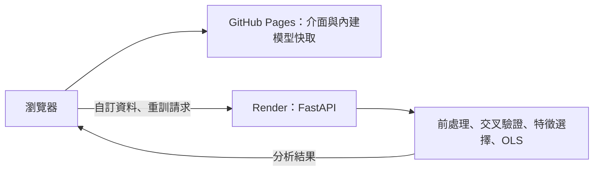

# DIC-2：Kaggle 50 Startups and Boston Housing

已部署上線的多元線性迴歸與特徵選擇網站，網站介面為英文，文件為繁體中文。前端使用原生 JavaScript、Chart.js 與紫色客製版面；後端使用 FastAPI、pandas、scikit-learn、statsmodels。內建模型由本專案分析引擎實際計算並快取，自訂資料則執行真正的前處理、選模與 OLS 訓練。


## 線上部署：GitHub Pages ＋ Render

- 前端網址：[Regression Explorer](https://maplenight0918.github.io/Regression-Analysis/)
- [Pages 部署工作流](https://github.com/maplenight0918/Regression-Analysis/actions/workflows/pages.yml)
- 後端網址：[Render API](https://regression-analysis-api-maplenight0918.onrender.com/api/health)。前端透過 `deployment.json` 連接此服務。
- **目前前後端已接通**：自訂 CSV 上傳、CSV URL 載入、自選特徵重訓皆已在線上正式網站實測成功。一般使用者直接開啟網站即可，不需再部署或安裝 Python。

| 操作 | 執行位置 | 是否需要 Render |
|---|---|---|
| 切換內建資料集、數值目標、seed、方法與 k | Pages 上的 42 份模型快取與瀏覽器 | 否 |
| 圖表、係數表、公式、殘差診斷、Live Predictor | 瀏覽器使用目前模型結果與係數 | 否 |
| 上傳 CSV、載入任意 CSV URL | Render 載入與檢查資料 | 是 |
| 修改候選特徵後按 Run Analysis、自訂資料訓練 | Render 執行 Python 分析 | 是 |



Render 暫時離線時，內建模型仍可瀏覽；自訂分析會顯示連線失敗或逾時，不會假裝完成訓練。若部署設定根本沒有填入後端網址，才顯示分析服務尚未連接。

### 如何使用線上網站

1. 選擇 **50 Startups** 或 **Boston Housing**，直接檢視已計算結果；預設為 **Lasso（L1）／seed 0**。
2. 切換 **Random seed**、**Numeric target**、方法按鈕、**Active model** 或 **Number of Features (k)**，比較結果。最佳模型依訓練集 CV 決定。
3. 點 **Load example** 可試用 **Restaurant Tips**；此範例也有完整快取。
4. 使用 **Dataset CSV URL → Load URL** 或上傳 CSV，確認資料預覽、數值目標及候選特徵。
5. 選定方法（或 **Compare All Methods**）後按 **Run Analysis**。自訂資料切換目標／seed 也會自動分析；修改候選特徵則需手動執行。
6. 在 **Live Predictor** 調整數值或類別，立即取得目前 OLS 模型的點預測。

### 重新部署或建立自己的 Render 後端

目前專案已有可用後端，以下步驟供複製專案或重新部署使用，不是瀏覽網站的必要步驟。

[](https://render.com/deploy?repo=https://github.com/maplenight0918/Regression-Analysis)

1. 點上面的按鈕，登入或註冊 Render，確認來源為本儲存庫。
2. 依 `render.yaml` 建立 Web Service。方案已明確設為 **Free**，不建立資料庫或付費磁碟；若平台畫面要求其他方案，先確認不要誤選付費項目。
3. 等服務狀態變成 **Live**，複製實際配發的 `https://…onrender.com` 網址。名稱可能有後綴，請勿自行猜測網址。
4. 開啟該網址的 `/api/health`，應回傳 `{"status":"ok","service":"dic2-regression"}`。
5. 將公開網址填入根目錄 `deployment.json` 的 `apiBase`，提交推送，Pages 會自動重建並連接後端。也可在 GitHub 儲存庫 **Settings → Secrets and variables → Actions → Variables** 設定 `API_BASE_URL`，再手動執行 Pages workflow；變數優先於檔案設定。這是公開服務網址，不是密碼。

Pages 的 Source 設為 **GitHub Actions**，不要選分支根目錄：原始碼需經 `scripts/build_pages.py` 匯出為 `dist/` 才能獨立運作。`.github/workflows/pages.yml` 自動安裝與模型快取相符的依賴、驗證快取、發布靜態檔案；缺少或過期快取會讓建置失敗，不會偷偷部署錯誤資料。

Render 使用 Python 3.11、`requirements-runtime.txt` 與單一 uvicorn worker。允許的前端來源為 `https://maplenight0918.github.io`（CORS origin 不包含 `/Regression-Analysis/` 路徑）。使用其他網域時需同步修改 `ALLOWED_ORIGINS`。上傳的 CSV 只暫存在服務記憶體，服務重啟後需重新上傳；內建資料有穩定 ID 可自動恢復。

免費 Render 閒置後可能休眠，第一次自訂分析須等待喚醒；前端請求逾時為 90 秒，可在錯誤提示後重試。內建模型完全從 Pages 讀取，不喚醒後端。免費方案運算資源有限，大型 Exhaustive Search 仍受 10,000 組合上限約束，其速度應以實際部署測試為準。

### 本機驗證 Pages 版本

```bash
pip install -r requirements-runtime.txt
python scripts/build_pages.py
python -m http.server 8765 --directory dist
```

開啟 http://localhost:8765 可預覽內建模型。此純靜態預覽仍載入 `deployment.json` 的正式 API 網址，而 Render 的 CORS 僅允許正式 Pages 網域；若要從本機實際訓練，請使用下方 FastAPI 本機啟動方式，或依測試設定啟動獨立本機 API。

匯出支援專案子路徑，所有 CSS、JS、字型與資料使用相對網址。前端測試 `tests/pages_browser_check.py` 另外驗證 `/Regression-Analysis/` 子路徑、42 組預存結果、無後端存取、手機版，以及對獨立 FastAPI 服務的真實跨來源 CSV 上傳／URL 載入／自選特徵訓練。輸出的 `dist/` 不提交 Git，也不包含後端原始碼、上傳檔或憑證。

官方文件：[GitHub Pages workflows](https://docs.github.com/en/pages/getting-started-with-github-pages/using-custom-workflows-with-github-pages)、[Render Blueprint](https://render.com/docs/blueprint-spec)、[Render 免費方案限制](https://render.com/docs/free)。

## 本機啟動

建議使用 **Python 3.11**，與正式部署環境一致。於專案目錄執行：

```bash
python -m venv .venv
source .venv/bin/activate
pip install -r requirements-runtime.txt
OPENBLAS_NUM_THREADS=1 OMP_NUM_THREADS=1 python -m uvicorn app:app --host 127.0.0.1 --port 8000
```

瀏覽 http://localhost:8000 ，首次開啟直接顯示已計算的完整分析結果，預設 seed 0、Lasso（L1 Ranking），並選擇該方法的最低 CV RMSE 模型；目前 50 Startups 對應 k=2（R&D Spend＋Marketing Spend）。網站介面、資料描述、圖表、統計說明、狀態與錯誤提示均使用英文。Random seed 可切換 0（參考站切分）或 42（作業原始設定）；兩種內建 problem、兩種 seed 都有持久化結果快取，重新整理或切換不需重新訓練。內建資料切換任一數值目標時直接讀取對應結果；自訂候選特徵組合需按 **Run Analysis**，恢復全選即可立即復用內建結果。Restaurant Tips 範例同樣有持久快取；其他自訂 CSV 切換目標時會實際分析。Windows 可使用 `.venv\Scripts\activate`，再執行 `python -m uvicorn app:app --port 8000`。

內建 CSV、Chart.js、繁體中文字型及圖示均隨專案保存；首次安裝 Python 依賴需網路，之後內建分析可離線使用。載入遠端 CSV 需要網路。本機完整版使用 Python 服務；GitHub Pages 版本由匯出腳本產生靜態內建模型，自訂分析另連接 Render，詳見上方部署說明。

## 功能

- 紫色工作區配置：左側資料設定、右側模型與分析、桌面側邊導覽／手機底部導覽。保留參考網站的演算法切換、五張指標、特徵 chips、兩張折線圖、公式、係數表、Live Predictor、殘差表與頁尾。
- 兩種 problem：50 Startups / Profit；Boston Housing / MEDV（原 CSV 欄位名稱為 `medv`）。切換時更新說明、來源、候選特徵、目標並清除舊結果。
- CSV URL 及本機 CSV 上傳；前 10 筆預覽、型態、缺失值統計；任選數值目標及候選欄位。
- Lasso、Forward SFS、RFE、ElasticNet、Exhaustive Search 及 Full OLS baseline。
- Compare All 顯示所有已執行方法的測試曲線；「目前檢視模型」及 k 按鈕同步更新全部分析區塊。圖表 tooltip 顯示特徵組合、測試值及 CV RMSE。
- 動態數值輸入／同步滑桿、類別選單、即時點預測。超出訓練範圍顯示外插提示，空白數值使用訓練中位數。
- 統計值不可計算時顯示 N/A 與原因；殘差依絕對值排序。

## 資料來源

已於 2026-10-15 實際下載並於網站驗證：

- [50 Startups 原始 CSV](https://raw.githubusercontent.com/Avik-Jain/100-Days-Of-ML-Code/master/datasets/50_Startups.csv)：50 筆、5 欄，目標 Profit。State 使用訓練集學到的類別順序，drop-first 編碼，全部特徵通常為 5 個。
- [Boston Housing 原始 CSV](https://raw.githubusercontent.com/selva86/datasets/master/BostonHousing.csv)：506 筆、14 欄，13 個候選特徵與 medv。MEDV 單位為千美元。不是 California Housing，也不依賴已移除的 `load_boston`。
- [Restaurant Tips 原始 CSV](https://raw.githubusercontent.com/mwaskom/seaborn-data/master/tips.csv)：244 筆、7 欄，預設目標 `tip`；涵蓋數值與類別欄位，編碼後最多 8 個候選特徵。

Boston Housing 為歷史教學資料，其 B 變數具有歧視性背景與解讀爭議；保留原始資料供課程重現，結果不宜用於現實住房政策或個人決策。

## 可重現分析流程

1. 以 CSV 型態辨識數值／類別欄位，非有限數值視為缺失。排除目標缺失的資料列，不補目標。固定 `train_test_split(test_size=0.2, random_state=所選 seed)`，所有方法共享相同測試集。Sample ID 為原 CSV 的 1-based 資料列編號。
2. 在 80% 訓練集做 5-fold shuffled CV（使用所選 seed，介面預設 0），每個 fold 重新學習前處理與特徵選擇。以各 fold RMSE 的平均值比較方法和 k；Full OLS 同樣納入比較。分數相同時優先較小 k，再依方法名稱排序。
3. 每個訓練 fold 數值使用中位數補值（全缺失使用 0）；類別使用眾數補值，建立排序後的 drop-first 虛擬變數。未知類別全部編為 0，即參考類別。完全缺失／常數欄位可能使 OLS 不滿秩，會標示統計限制。
4. Lasso / ElasticNet：X 與 y 都在當前訓練 fold 標準化，固定 alpha=0.01，ElasticNet l1_ratio=0.5，按係數絕對值排序。零係數平手按編碼欄位順序處理。這些超參數固定，沒有使用測試集調整。
5. RFE：以當前訓練 fold 標準化的線性模型，每次移除絕對係數最小的特徵。
6. Forward SFS 與 Exhaustive：在當前訓練 fold 內另做 3-fold shuffled CV（使用所選 seed，介面預設 0）。各內層 fold 獨立學習補值、編碼與標準化；驗證 fold 不參與擬合。SFS 逐步加入最小 CV RMSE 的候選，Exhaustive 確實列舉範圍內全部組合。若內層訓練集未見某類別，對應虛擬欄位為 0，不從驗證集學習。外層 fold 會重新執行整套選擇流程。
7. 由訓練 CV 決定最佳方法／k **之後**，於完整訓練集重新選擇特徵、擬合 OLS，才產生測試集預測。模型以標準化設計矩陣穩定求解，係數與共變異數矩陣正確轉回原始單位；公式與即時預測使用未四捨五入的係數。
8. RMSE、MAE、R² 來自測試集；Adjusted R²、F 與 p-value 來自訓練 OLS。VIF 在含截距的設計矩陣計算。秩不足時係數為廣義逆解、不唯一，保留點預測，但 SE／t／p／CI／F／Adjusted R² 顯示 N/A；截距 VIF 不適用。傳統選模後推論未校正選模效應，僅供探索。
9. 殘差 = 實際 − 預測；百分比誤差 = 100 × |殘差 / 實際|，實際為 0 顯示 N/A。高殘差門檻 = 2 × 訓練 RMSE，只是診斷提示，不是正式離群值檢定。

測試曲線為事後比較圖，不拿測試 RMSE 選擇最佳模型。使用者手動挑選其他模型不改變「CV 最佳」標籤。CV 最佳僅限**本次已執行的方法與 k 範圍**；CV 最小分數仍可能有選擇樂觀偏誤，獨立測試集提供最終評估。

## 運算上限與限制

- CSV：UTF-8、逗號分隔、有表頭；5 MB、25～5,000 筆、2～60 欄。數值欄若混入非數字文字會被辨識為類別，請先清理資料。
- 最多 30 個編碼後候選特徵。需足夠的內層訓練樣本與至少 25 筆有效目標；常數目標拒絕分析。
- Exhaustive 每次選模輪次最多 10,000 個組合，完整曲線的計數為 `2^p - 1`；外層 5 次加完整訓練 1 次，每組合再評估 3 個內層 fold。超限時只跳過 Exhaustive 並顯示原因，其餘方法照常計算；若只選 Exhaustive 則明確拒絕。可減少候選欄位縮小範圍，沒有替換演算法。每個 fold 的前處理矩陣只擬合一次，各組合以數值穩定的最小平方法求解，已與獨立 sklearn 模型驗算一致。
- 無「搜尋最大 k」控制。自動比較 k=1 到全部編碼後特徵：50 Startups 全五方法 k=1～5；Boston 全五方法 k=1～13（Exhaustive 為 8,191 個組合）。兩個 seed 都已重新計算並快取。Full OLS 始終包含全部候選特徵。
- 稀有類別可能讓某 fold 可用編碼特徵少於 k，此時明確要求減少候選欄位或合併稀有類別。
- 單機教學服務：同時一個分析工作；記憶體最多保存 20 份資料與約 30 個工作，重啟後清除。沒有帳號、持久化工作、排程、分析取消或多租戶隔離。分析期間可切換資料，舊工作仍會完成但不會覆蓋新畫面；內建 problem 或 seed 優先直接顯示符合設定的持久化結果；未命中快取時，最新選擇會排隊自動重算。請以單一 uvicorn worker 執行。
- URL 來源需公開 HTTP(S)，會拒絕非公開 IP、過大檔案、過多重新導向與逾時。目前公開部署供課堂展示使用；若要提供多人長期使用，需另加身分驗證、運算配額與工作佇列。

## 驗證與截圖

### 已完成的正式網站驗證

在 GitHub Pages 正式網址連接 Render 後端，已實際完成以下驗證（串接版本：[`3d2fa59`](https://github.com/maplenight0918/Regression-Analysis/commit/3d2fa5955004df0e788d7043d4637a29640d69c2)）：

- 內建 Startups／Boston、seed 切換不發出 Render API 請求。
- 取消 State 後，透過 Render 真正重新訓練 Startups 的自選特徵模型。
- 上傳 Tips CSV，訓練 `tip` 模型並檢查係數、完整特徵 OLS 與即時預測。
- 從指定的公開 50 Startups URL 載入並訓練，共完成 **3 次真實訓練請求**。
- 跨來源連線正常；390px 手機無頁面水平溢出，沒有 JavaScript 執行錯誤。

其他回歸驗證涵蓋 42 組內建目標／seed 快取、Boston 五方法 k=1～13、方法與模型同步、候選特徵順序、缺失值與統計限制、英文錯誤提示及版面對齊。

### 執行測試

```bash
# 固定數值套件版本，另外安裝測試工具
pip install -r requirements-cache.txt
OPENBLAS_NUM_THREADS=1 OMP_NUM_THREADS=1 python -m pytest -q

# 先在另一個終端啟動本機網站（port 8000）
mkdir -p artifacts
PLAYWRIGHT_BROWSERS_PATH=/tmp/dic2-browsers python -m playwright install chromium
python tests/full_progression_browser_check.py
python tests/target_switch_browser_check.py
python tests/tips_cache_browser_check.py
python tests/english_example_browser_check.py
```

`tests/pages_browser_check.py` 是獨立的 Pages／跨來源整合測試。需在三個終端分別啟動 API、靜態預覽及測試；以下設定不會變更正式 `deployment.json`：

```bash
# 終端 1：測試 API
ALLOWED_ORIGINS=http://127.0.0.1:8765 OPENBLAS_NUM_THREADS=1 OMP_NUM_THREADS=1 python -m uvicorn app:app --host 127.0.0.1 --port 8001

# 終端 2：不連接後端的靜態版本，保留與 Pages 相同的子路徑
python -c "from scripts.build_pages import build; build('dist/Regression-Analysis', api_base='')"
python -m http.server 8765 --bind 127.0.0.1 --directory dist

# 終端 3：先驗證零後端模式，再於測試瀏覽器接上 port 8001
python tests/pages_browser_check.py
```

`artifacts/` 是本機產生的截圖與驗證報告，不納入 Git。正式線上驗證報告為 `render-live-verification.json`，截圖為 `render-connected-desktop.png`／`render-connected-mobile.png`；這些是本次驗證產物，不會隨 clone 自動下載。改版前的還原快照與截圖則有保存在 `backups/`。

## 檔案與設計參考

- `analysis.py`：前處理、選模與統計。
- `app.py`：FastAPI、CSV 載入與背景分析工作。
- `static/`：完整前端、在地化字型、圖示與 Chart.js。
- `data/`：已驗證的公開 CSV 快照。
- `data/presets/`：42 份已驗證的模型結果。
- `deployment.json`：Pages 使用的公開後端網址。
- `.github/workflows/pages.yml`：GitHub Pages 自動建置與發布。
- `render.yaml`／`requirements-runtime.txt`：Render 免費服務及執行環境。
- `scripts/build_pages.py`：匯出靜態網站與模型快取。
- `scripts/build_presets.py`：重建失效或缺少的模型結果。
- `scripts/restore_layout.py`／`backups/`：舊版本機版面還原。
- `tests/`：統計、快取、部署與瀏覽器測試。

實際檢視 [參考網站](https://huanchen1107.github.io/AIoT-DIC2-MultipleLR/)、其內嵌 JavaScript 及 [model_data.js](https://huanchen1107.github.io/AIoT-DIC2-MultipleLR/model_data.js)，並沿用其 CSS 版面與視覺語言（原站另參考 StatsUnlock）。本專案改寫互動及資料流程，修正固定最佳 k／過度擬合／F 值 fallback 文案。參考站 CSS 的原始著作權歸原作者，作為指定課堂重現使用；再散布前請自行確認原作者授權。

第三方：Chart.js 4.4.1（MIT，檔案內保留授權標頭）；Font Awesome Free 6.5.1（圖示 CC BY 4.0、字型 SIL OFL 1.1、程式碼 MIT）；Noto Sans TC（SIL Open Font License，見 `static/fonts/OFL.txt`）。

Seed 0 的 Lasso k=2（R&D Spend＋Marketing Spend）已驗證 Test RMSE=8,198.79719078855、R²=0.947438644726848，重現參考站該模型。其餘方法仍沿用本作業的訓練集交叉驗證流程，因此 seed 0 不代表所有選模與統計定義都與原站一致。


## 內建結果快取

`data/presets/` 保存以本專案分析引擎實際計算的 42 份結果：50 Startups 的 4 個數值目標、Boston Housing 的 14 個數值目標、Restaurant Tips 的 3 個數值目標，各有 seed 0 與 42。每個目標都以其餘欄位作為候選特徵，產生所有方法的完整 k 曲線。它們不是複製參考站的固定數據。本機版由 FastAPI 回傳結果；Pages 版在建置時匯出 JSON，瀏覽器直接讀取。進站、重新整理與完整候選集合下切換資料／seed 都不會呼叫訓練 API。

快取以 CSV 內容、`analysis.py` 內容、seed、方法、目標、完整 k 範圍及數值套件版本的 SHA-256 指紋驗證。目標欄位、seed 分別索引不同快取；候選欄位不是該目標的完整候選集合時，不套用內建結果；自訂 CSV 仍由分析引擎處理。資料、分析程式或依賴版本變動後請執行：

```bash
OPENBLAS_NUM_THREADS=1 OMP_NUM_THREADS=1 python scripts/build_presets.py
```

此指令只重建失效的內建結果，不必每次啟動執行。本機版若快取缺失或失效，會退回實際分析；Pages 匯出則會直接讓建置失敗，需先重建快取再發布。要在其他環境直接使用隨附快取，可安裝 `requirements-cache.txt` 中與快取一致的數值套件版本；否則先執行上述重建指令。

## Sweet Spot / Cliff 視覺標籤

主視覺綠色 `Optimal Sweet Spot` 由本次所有模型的 CV 最佳結果產生；k 按鈕與圖表綠點標示目前方法的最低 CV RMSE（平手取較小 k）。橘色 `Overfitting Cliff 候選` 標示同一方法相鄰 k 中 Test RMSE 上升至少 5% 且增幅最大的點。5% 是明確的介面提示門檻，不是統計顯著門檻；沒有符合條件的點時明確顯示未見候選。此提示不代表已證實過度擬合，也不參與模型選擇。兩種標籤可能出現在同一 k，因為 CV 與測試集評估的是不同資料。


## 目標切換與候選特徵

Problem 選單只顯示資料集名稱。目標由獨立的數值目標選單決定，英文 description、公式、預測器和全部指標同步更新。內建目標結果按需讀取並保留於瀏覽器記憶體，切換回先前目標或重新全選候選特徵時直接復用，無需訓練；伺服器磁碟快取在重新整理後仍有效。

自選候選特徵組合不全面預先計算；修改後隱藏舊結果並暫停 k 按鈕，顯示目前編碼後特徵數量的遞增序列，按 **Run Analysis**後才可檢視。所有 k 按鈕及模型選單固定依方法／數值 k 排序，與 CV 分數排序分開，避免 Compare All 後順序錯亂。CHAS 等二元欄位也可作為 OLS 的數值目標進行探索；它仍是線性迴歸，不會自動改成分類模型。


## 自訂資料範例：Restaurant Tips

Problem 選單新增 **Custom CSV**。點選 **Load example**，會載入隨附的 [Seaborn 公開 Tips CSV](https://raw.githubusercontent.com/mwaskom/seaborn-data/master/tips.csv) 快照及經本專案引擎實際計算的持久化結果。Problem 顯示 **Custom · Restaurant Tips**。`tip`、`total_bill`、`size` 各有 seed 0／42 的完整五方法快取；重複載入、重新整理後載入、切換目標與 seed 都不需重新訓練。自行修改候選特徵仍需手動分析，恢復全選即復用快取。

- 244 筆、7 欄，目標 `tip`。
- 候選欄位：`total_bill`、`sex`、`smoker`、`day`、`time`、`size`。
- 訓練集 drop-first 編碼後為 8 個特徵；比較 k=1～8，共 40 個選模模型及 Full OLS。
- 可修改數值目標、比較方法、使用數值輸入／滑桿與類別選單預測。
- 範例按鈕使用 `data/tips.csv`，不需連線下載；自行輸入 URL 或上傳 CSV 仍走一般分析流程，不套用範例快取。
- 測試：`python tests/english_example_browser_check.py`，驗證英文介面、遠端／本機 CSV、全五方法、動態目標、預測、英文錯誤與手機版。

README 與對話保留繁體中文，網站 UI 使用英文。自訂 CSV 的原始欄位名稱與類別值不強制翻譯，以保留使用者資料。

Restaurant Tips 快取回歸測試：`python tests/tips_cache_browser_check.py`，涵蓋三個目標、兩個 seed、恢復全選、重複載入與重新整理後載入，確認零訓練請求。

## 2026-10-16 紫色工作區改版與還原

版面參考 [Linear](https://linear.app/features) 的工作區導覽及 [Untitled UI](https://www.untitledui.com/components/dashboards) 的卡片與資訊層次。保留原有英文 UI，新增 `static/workspace.css`、重排 `static/index.html`；當次版面改版保留分析引擎與模型結果；後續 `app.js` 已加入快取效能改善、GitHub Pages 靜態資料與 Render API 串接。桌面將資料設定置左、分析結果置右；手機改為單欄和底部區段導覽。

改版前完整前端保存在 `backups/layout-before-purple-20261016/static/`，包括 CSS、JavaScript、字型及圖示。`manifest.json` 記錄檔案 SHA-256，`desktop.png`／`mobile.png` 記錄原始版面。

還原舊版：

```bash
python scripts/restore_layout.py
```

還原指令會先校驗快照，將當前前端另存到 `backups/before-restore-時間戳/`，再恢復舊版前端。本機網站重新整理即可，後端和資料快取不受影響。**此快照早於 Pages／Render 串接，還原會覆蓋前端 API 與路徑改動；不可直接將還原後的前端發布到 Pages，需先重新套用部署相容處理。**已在暫存目錄實測還原後全部快照檔案雜湊一致，且新版會另行保留。

驗證：`full_progression_browser_check.py`、`target_switch_browser_check.py`、`tips_cache_browser_check.py`、`english_example_browser_check.py`，涵蓋內建全部目標／seed、Boston k=1～13、五種方法與比較模式、Tips 快取、自選特徵、CSV 上傳、動態預測、錯誤提示、英文介面及手機排版。新版截圖：`artifacts/purple-desktop.png`、`artifacts/purple-mobile.png`。

## Problem 切換效能修正

原先每次切換都重新取得整包兩個 seed 的結果，Boston 約 2.6 MB；雖不重新訓練，仍有序列化與傳輸成本。現在同一頁面中的內建資料與 Tips 範例只載入一次，並共用尚未完成的請求；伺服器直接序列化已驗證的 JSON，啟用 gzip 壓縮。資料描述使用穩定的內建 ID，伺服器重啟或資料被記憶體上限淘汰後，手動分析仍可重建內建資料，不套用到任意自訂 CSV。

以下為先前本機 FastAPI 版本的效能量測，並非 Render／Pages 線上服務的效能保證。Pages 現在直接讀取靜態模型結果。

本機 Chromium 單次量測：Boston 原先切換 1.27～1.43 秒，修正後首次約 0.59 秒、再次切換約 0.13 秒；gzip 傳輸約 590 KB。此數字為本機測試結果，實際依裝置及連線而異。重新整理會建立新的瀏覽器記憶體快取，但仍直接讀取磁碟模型結果，不重新訓練。

測試：`python -m pytest tests/test_builtin_transport.py tests/test_presets.py -q`、`python tests/problem_switch_browser_check.py`，涵蓋壓縮、重複切換、快速連續選擇、請求合併與內建資料被淘汰後重新分析。數據存於 `artifacts/switch-*-before.json`、`artifacts/switch-*-after.json`（API 量測為 `switch-before.json`／`switch-after.json`）。

`artifacts/` 為本機驗證截圖與報告，未納入 Git；執行瀏覽器測試前可先建立此目錄（`mkdir -p artifacts`）。原始版面備份仍隨專案保存於 `backups/layout-before-purple-20261016/`。
